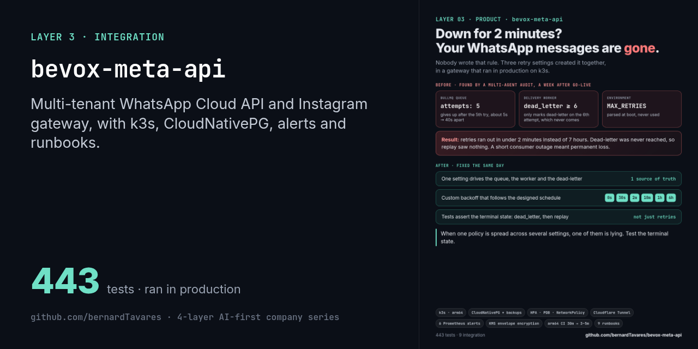
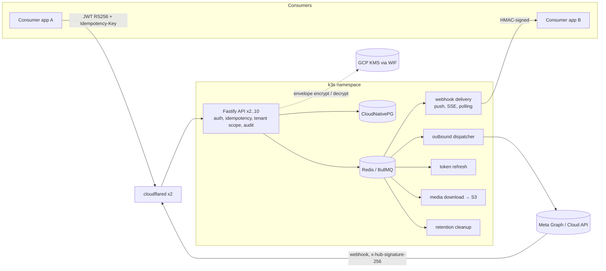

# Bevox Meta API

[](#) [](./LICENSE.md)  



> Part of the [4-layer AI-first company series](https://github.com/bernardTavares). License: FSL-1.1-MIT (source-available, converts to MIT after 2 years)

A multi-tenant HTTP gateway over Meta's **WhatsApp Cloud API** and **Instagram Graph API**. Any number of consumer apps get one surface for onboarding business numbers, sending messages, receiving webhooks and managing tokens, templates and rate limits. They never touch Meta's API directly.

It is the messaging layer of **Bevox**, an AI secretary for appointment-based businesses on WhatsApp and Instagram, built by one person in 2026.

> **Status: ran in production.** V1 went live on 2026-05-27 on a single-node k3s cluster (Hetzner, arm64) and served Bevox's own two consumer apps. Treat it as a reference implementation of a Meta messaging gateway and its operations, not as a supported product.

## Why a gateway

Every product that talks to WhatsApp has to rebuild the same hard parts:
- Meta's onboarding flows;
- long-lived token custody and refresh;
- webhook signature checks;
- per-number rate limits, retries and dead letters.

Those are also the most compliance-sensitive parts of the code. I had built these integrations several times for clients before, so this time I put them behind one service with **no business domain**. It stores only Meta-layer state: tokens, WABA/phone/Instagram bindings, the send queue, inbound events and rate-limit buckets. Consumers identify themselves with an opaque `app_id` plus `tenant_id`.

## What's inside

| Area | What it does |
|---|---|
| **Onboarding** | OAuth callback, Meta **Embedded Signup** (code exchange → WABA discovery → per-WABA webhook subscription → persist) and **Coexistence**, which onboards a number already in use on the WhatsApp Business app and triggers history and contact sync. Instagram OAuth too. |
| **Token custody** | Per-tenant **envelope encryption**: AES-256-GCM data keys wrapped by **GCP Cloud KMS**, with AAD bound to `(tenant_id, waba_id, app_id, version)` so a ciphertext can't be swapped between tenants. KMS auth uses **Workload Identity Federation** from k3s, with no service-account keys. `/readyz` runs a real KMS round-trip. |
| **Consumer auth** | RS256 JWTs with `kid` rotation and a lifetime of 5 minutes or less. A separate admin plane with its own auth. |
| **Outbound** | Synchronous send, plus an async path. The async path seals the job payload (request body and callback secret) before it enters Redis. A worker then sends it to Meta and posts an HMAC-signed callback to the consumer. |
| **Inbound** | Raw body → HMAC check **before** `JSON.parse` → dedup → persisted event → per-subscription delivery. Delivery is a signed push with backoff `[0s, 30s, 2m, 10m, 1h, 6h]`, then dead letter and replay. Consumers that can't take a push can use **SSE** or **polling** instead. |
| **Safety** | Idempotency keys on every mutation, an immutable audit log, token-bucket rate limits per number, an SSRF allowlist on media download, and PII and secret redaction in logs, traces and Sentry. |
| **Workers** | Five BullMQ workers: outbound dispatcher, webhook delivery, token refresh, retention cleanup, and media download to S3/MinIO. |
| **Contract** | A 1,300-line OpenAPI 3 spec (`docs/architecture/openapi.yaml`) that generates the TypeScript types. |
| **Consumer skill** | `skills/bevox-meta-api-consumer/` is a packaged Claude Code skill. It teaches an agent working in another repo how to integrate with this API, with a JWT signer, a client and webhook handlers. |

Stack: Node.js 22, TypeScript (strict), Fastify 5, Drizzle ORM, PostgreSQL 16, Redis 7, BullMQ, Zod, Pino, OpenTelemetry, Sentry, Vitest.

## Infrastructure and operations

This is the part of the repo I'd point a DevOps reviewer to.

| Area | What's there |
|---|---|
| **Kubernetes** (`k8s/`) | **k3s** manifests: CloudNativePG cluster with scheduled backups, Redis StatefulSet (AOF), API Deployment (2 replicas, HPA 2–10, PDB), five worker Deployments, a migration Job, NetworkPolicy, and in-cluster **cloudflared** (2 replicas). The public endpoint goes through a Cloudflare Tunnel, so the host has no open inbound ports. |
| **Observability** (`k8s/observability/`) | Prometheus ServiceMonitor; a PrometheusRule with 6 alerts (no ready replicas, 5xx rate, Meta p99 latency, dead letters growing, token disconnected, cleanup worker down); a Grafana dashboard; OTLP traces. |
| **Image** | Multi-stage Dockerfile with separate runtime and one-shot **migrator** images, non-root, with a healthcheck. |
| **CI** | GitHub Actions builds both images on a **native arm64 runner** and pushes them to GHCR. Moving from QEMU emulation to the native runner took builds from timing out at 30 minutes down to 3–5 minutes. |
| **Runbooks** (`docs/runbooks/`) | Incident response, Meta outage, disaster recovery, dead-letter replay, JWT and consumer-key rotation, token refresh, WABA disconnect recovery, GCP KMS provisioning. |
| **Go-live plan** | `docs/ops/2026-05-25-go-live-prod-plan.md` is the plan that took V1 to production. It includes a full dry run on a local k3s cluster first. |
| **Admin CLI** | `pnpm cli`: provision consumer apps, rotate keys, replay dead letters. |

## Architecture



## Quick start

```bash
git clone https://github.com/bernardTavares/bevox-meta-api.git
cd bevox-meta-api
corepack enable && pnpm install --frozen-lockfile    # Node 22.19+
pnpm test                    # 443 unit tests, no infrastructure needed
pnpm test:integration        # 9 tests against real Postgres + Redis (needs Docker)
pnpm lint && pnpm typecheck && pnpm build
```

To run it locally, copy `.env.example` to `.env`, start the dependencies with `docker compose up -d postgres redis`, then run `pnpm migrate:up` and `pnpm dev`. With `KMS_PROVIDER=local` you don't need GCP. You do need a Meta app of your own to onboard real numbers.

Some details still point at the original deployment:
- **Image tags.** The k8s manifests reference image tags from that deployment. Build and push your own image, then update the tags.
- **Runtime.** It runs TypeScript through `tsx` (`node --import tsx/esm src/index.ts`). The `@/` and `@db/` path aliases are not rewritten in `dist/`, so `pnpm build` acts as a type-checked compile, not the runtime artifact.
- **Single node.** The cluster ran on one k3s node. The HPA and PDB are in place, but multi-node failover was never exercised.

## How this was built

As one person, AI-native:
1. A product spec came first: an 888-line PRD (`prds/`), architecture decision records, and the OpenAPI contract.
2. The spec was broken into tasks with TaskMaster (`.taskmaster/`).
3. Claude Code implemented the tasks under repo-local rules, hooks and reviewer agents (`.claude/`, `CLAUDE.md`).
4. After go-live, scheduled multi-agent audits tried to break each claim against the running code. Every gap they found was fixed in its own branch, with a test (`docs/audits/`).

Most of the ADRs (MA-001 to MA-014) lived in a separate knowledge repository. This repo keeps MA-015 and MA-016. The PRD, ADRs, runbooks and audits are written in Portuguese. The code, the API contract and this README are in English.

## License

[Functional Source License 1.1, MIT Future License](./LICENSE.md) (FSL-1.1-MIT). Copyright 2026 Bernard Tavares.

You may use, modify and redistribute it for any purpose except a competing commercial product or service. Each version becomes MIT-licensed two years after its release.
